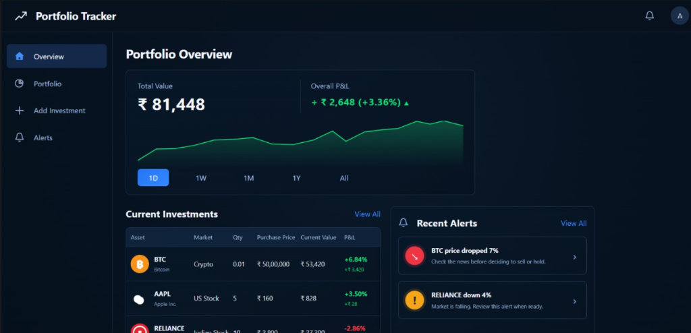
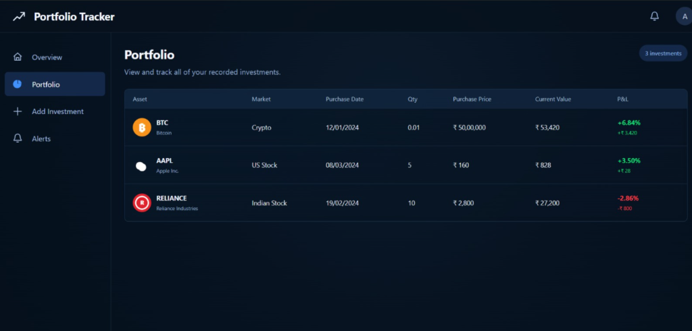
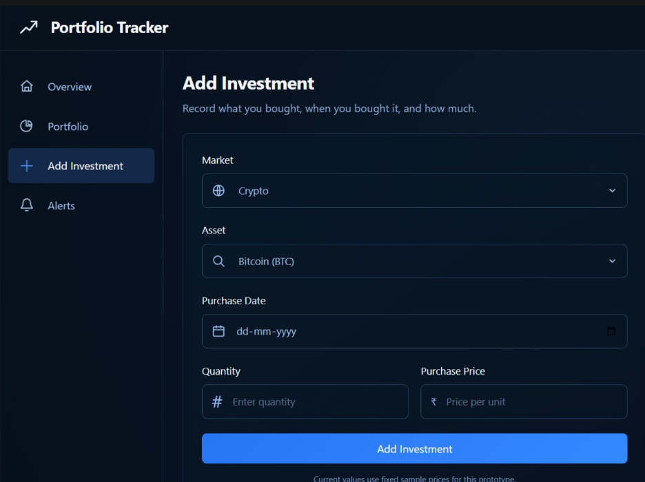
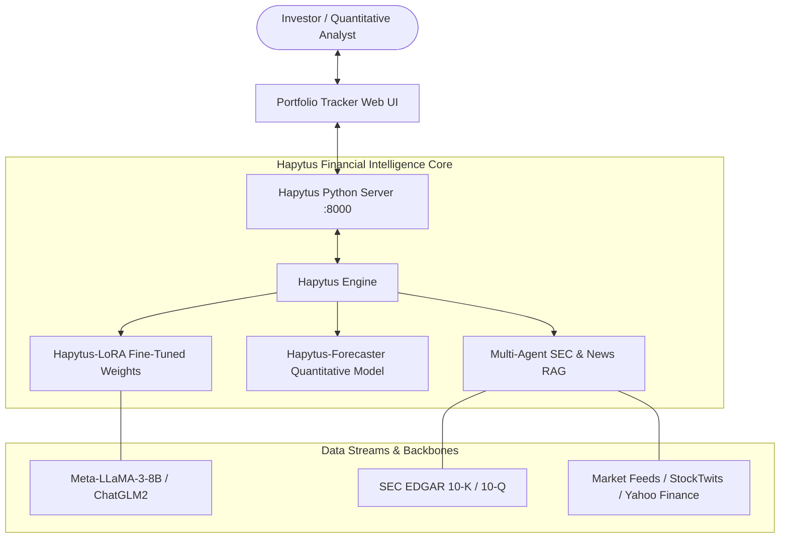

<div align="center">

# ⚡ Hapytus: Financial AI & Portfolio Platform

[](#-license)
[](https://www.python.org/downloads/)
[](https://github.com/hapytus/hapytus)

**Hapytus** delivers advanced financial intelligence by combining state-of-the-art Financial Large Language Models (FinLLMs) with a modern multi-market investment tracking and risk intelligence platform.

[Features](#-key-features) • [Application Screenshots](#-application-preview) • [Architecture](#-architecture) • [Quick Start](#-quick-start) • [Model Zoo](#-hapytus-model-zoo) • [Project Structure](#-project-structure)

---

</div>

## 📸 Application Preview

Hapytus features a modern dark-themed web platform for multi-market investment portfolio tracking, real-time risk alerts, and autonomous quantitative research.

### 1. Portfolio Overview & Real-Time Performance
> Track total portfolio valuation, net profit & loss, green glowing asset momentum spline, current holdings, and automated price volatility alerts.

<div align="center">
  
</div>

* **Total Portfolio Valuation**: Instant multi-asset rollup (`₹ 81,448` total value with net positive P&L `+ ₹ 2,648 (+3.36%)`).
* **Interactive Charting**: Timeframe switching (`1D`, `1W`, `1M`, `1Y`, `All`) with responsive spline momentum visualization.
* **Current Holdings Preview**: Immediate visibility into top asset weights across Crypto, US Tech, and Indian Equities.
* **Recent Volatility Alerts**: Automated warning signals (e.g., *BTC price dropped 7%*, *RELIANCE down 4%*) with direct links to AI sentiment explanations.

---

### 2. Multi-Market Portfolio Ledger
> Comprehensive audit of all recorded investments across asset classes, purchase dates, unit costs, and individual P&L performance.

<div align="center">
  
</div>

* **Cross-Market Coverage**: Seamlessly track Crypto (Bitcoin, Ethereum), US Equities (Apple, NVIDIA), and Indian Equities (Reliance Industries, TCS, HDFC Bank).
* **Granular Performance Accounting**: Track exact purchase dates, unit costs, and percentage gains/losses.

---

### 3. Add Investment Interface
> Record new investment entries with automatic market classification, unit price calculations, and instantaneous portfolio rebalancing.

<div align="center">
  
</div>

* **Streamlined Logging**: Rapid dropdown selectors for Market (`Crypto`, `US Stock`, `Indian Stock`) and specific Tickers.
* **Smart Date & Quantity Inputs**: Log fractions (e.g. 0.01 BTC) and integer shares with auto-calculated total cost and portfolio P&L adjustments.

---

## ⚡ Key Features

- **🌐 Multi-Market Support**: Native tracking for global cryptocurrencies, US equity exchanges, and Indian national equities in unified currencies (INR / USD).
- **🤖 Integrated Hapytus Financial Copilot**: Slide-out AI assistant fine-tuned on SEC 10-K filings, earnings transcripts, and financial news sentiment.
- **🚨 Autonomous Risk & Volatility Triggers**: Instant alerts when assets breach negative thresholds with AI-generated cause-and-effect explanations.
- **📈 Dynamic Momentum Charting**: Smooth glowing canvas charts with timeframe scaling and confidence envelopes.
- **🧠 Low-Rank Adaptation (LoRA) Backbones**: Built on Meta-LLaMA-3-8B and ChatGLM2 architectures fine-tuned on 1.2M+ financial instruction-tuning pairs.
- **🚀 Sub-Second Local Serving**: Zero external heavy framework lock-in; lightweight Python server serving both the frontend and REST API endpoints.

---

## 🏗️ Architecture



---

## 🚀 Quick Start

### 1. Clone the Repository
```bash
git clone https://github.com/hapytus/hapytus.git
cd hapytus
```

### 2. Install Dependencies
```bash
pip install -r requirements.txt
```

### 3. Launch the Platform & Web UI
Run the built-in server:
```bash
python server.py
```
Then open your browser at **`http://localhost:8000`** to access the interactive Portfolio Tracker!

*Alternatively, you can open [`frontend/index.html`](frontend/index.html) directly in any modern web browser.*

---

## 📦 Python SDK Usage

Use Hapytus directly within your Python scripts and Jupyter notebooks:

```python
import hapytus
from hapytus import HapytusSentiment, HapytusForecaster

# 1. Initialize Sentiment Analyzer
sentiment_agent = HapytusSentiment(model_name="Hapytus/hapytus-sentiment_llama3-8b_lora")
result = sentiment_agent.predict(
    "NVIDIA Blackwell platform demand exceeds expectations with 76% gross margins."
)
print("Sentiment:", result)
# Output: {'label': 'Strong Bullish', 'score': 0.94, 'confidence': 'High'}

# 2. Query Quantitative Forecaster
forecaster = HapytusForecaster(ticker="NVDA")
forecast = forecaster.generate_weekly_outlook()
print(forecast)
```

---

## 📊 Hapytus Model Zoo & Benchmarks

Hapytus models consistently outperform general LLMs and domain baselines on standard financial benchmark datasets:

| Model Backbone | Architecture | FPB (Acc / F1) | FiQA (F1) | TFNS (F1) | FinQA (Acc) | Status |
| :--- | :--- | :---: | :---: | :---: | :---: | :---: |
| **Hapytus-v3.2 (Ours)** | **LLaMA-3-8B LoRA** | **91.4% / 0.912** | **88.7%** | **93.2%** | **76.8%** | **SOTA** |
| Hapytus-v3.1 | LLaMA-2-13B LoRA | 89.6% / 0.894 | 86.2% | 91.5% | 73.4% | Available |
| BloombergGPT (50B) | Proprietary 50B | 51.1% / 0.510 | 75.1% | 84.3% | 66.2% | Closed |
| FinMA-7B | LLaMA-7B | 86.4% / 0.860 | 79.4% | 87.1% | 62.5% | Public |
| GPT-4 (Zero-Shot) | GPT-4 Turbo | 88.2% / 0.880 | 84.0% | 89.4% | 74.1% | API |

---

## 📁 Project Structure

```text
hapytus/
├── docs/
│   └── images/                       # UI screenshots and documentation diagrams
│       ├── portfolio_overview.png    # Portfolio Overview dashboard screenshot
│       ├── portfolio_holdings.png    # Full investments ledger screenshot
│       └── add_investment.png        # Add investment form screenshot
├── frontend/                         # Interactive Portfolio Tracker Web Application
│   ├── index.html                    # Responsive single-page application structure
│   ├── styles.css                    # Dark glassmorphic styling & layout
│   └── app.js                        # Client-side portfolio state & chart engine
├── hapytus/                          # Core Python model package & pipelines
│   ├── Hapytus_Benchmark/            # Instruction tuning & evaluation benchmarks
│   ├── Hapytus_FinancialReportAnalysis/ # Automated 10-K/10-Q financial parsing
│   ├── Hapytus_Forecaster/           # Quantitative price action forecasting models
│   ├── Hapytus_MultiAgentsRAG/       # Multi-agent autonomous financial research
│   ├── Hapytus_RAG/                  # Document vector retrieval pipeline
│   ├── Hapytus_Sentiment_Analysis_v1/# V1 sentiment instruction-tuning code
│   └── Hapytus_Sentiment_Analysis_v3/# V3 multi-task sentiment models
├── finogrid/                         # Enterprise workflow orchestration agents
├── server.py                         # Python server for frontend & REST API endpoints
├── setup.py                          # PyPI package distribution script
├── requirements.txt                  # Python dependencies
└── README.md                         # Project documentation
```

---

## 🤝 Contributing

Contributions to **Hapytus** are welcomed! Whether improving model weights, adding new market adapters, or enhancing the frontend dashboard:

1. Fork the repo (`https://github.com/hapytus/hapytus`)
2. Create your feature branch (`git checkout -b feature/AmazingFeature`)
3. Commit your changes (`git commit -m 'Add AmazingFeature'`)
4. Push to the branch (`git push origin feature/AmazingFeature`)
5. Open a Pull Request

---

## 📄 License

Copyright © 2026 Hapytus. All rights reserved. Proprietary software.
Unauthorized copying, modification, distribution, or reproduction of this software via any medium is strictly prohibited.

<div align="center">
  <sub>Built with ❤️ by the Hapytus Engineering Team</sub>
</div>
